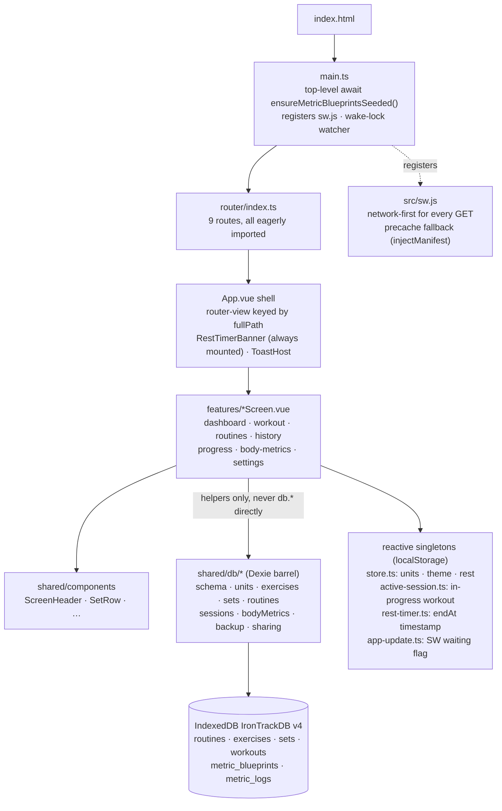
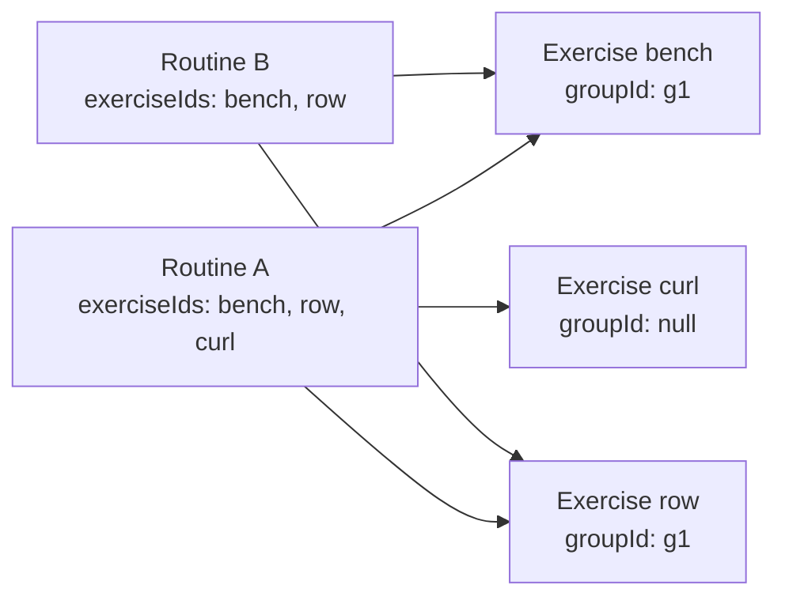
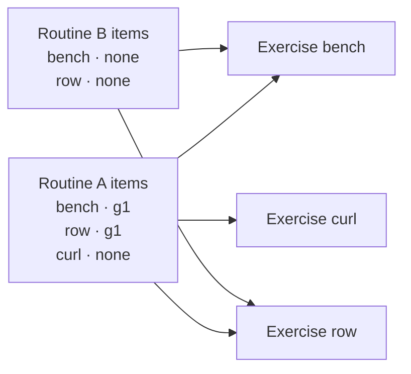
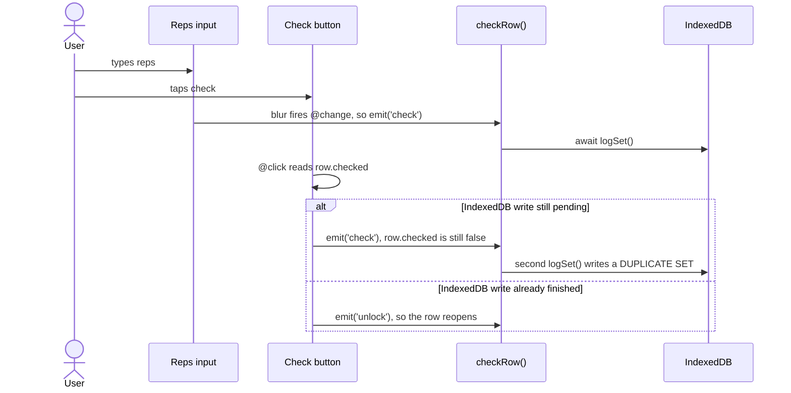
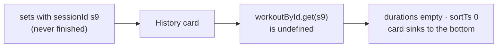
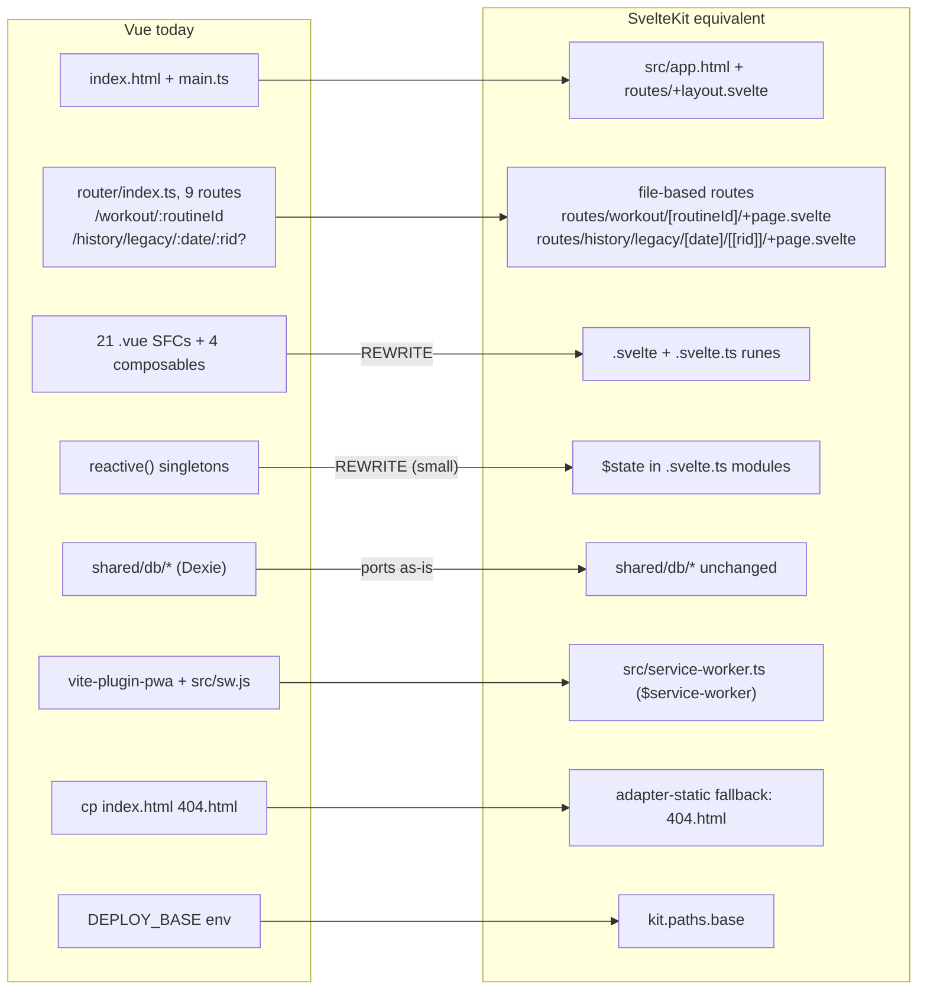
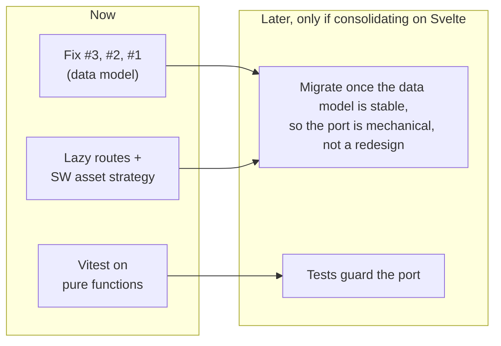

# IronTrack Code Review: Architecture, Bugs, SvelteKit

**Date:** 2026-11-10 · **Version reviewed:** 2.4.1 (`bd7a07e`) · **Scope:** quick review, not exhaustive

## TL;DR

- **Migration verdict: stay on Vue.** The app is IndexedDB-only and hosted as static files, so SvelteKit's main features (SSR, `load`, form actions, server routes) don't apply. A rewrite covers about 3,500 lines (21 SFCs plus 4 composables) and fixes none of the bugs below. Switching would mainly buy consistency with your other Svelte projects, not a technical improvement.
- **Top 3 bugs:**
  1. **Superset/circuit groups are global.** `groupId` is stored on `Exercise`, so grouping two exercises in one routine groups them in every routine that uses them, including duplicates.
  2. **Routine Builder writes before Save.** Grouping and type changes are saved to the DB immediately, so backing out without saving still keeps them.
  3. **Logging a set can run twice.** The reps `@change` and the check-button `@click` can both call `checkRow` while the first call is still awaiting the write. Depending on timing, the result is a duplicate set or a row that unlocks itself.
- **Cheapest high-value work:** lazy-load the routes, serve hashed assets cache-first in the service worker, and add Vitest for the pure functions.

---

## 1. Architecture as it stands



**What works well**

- **One data boundary.** Every DB call goes through `shared/db/*` helpers, and conversion happens at write time (`weightInLbs` and `valueBaseline` are the canonical values). This is easy to reason about.
- **Wall-clock timer.** `rest-timer.ts` stores an end timestamp instead of counting down, so it survives backgrounding and reloads correctly.
- **Careful additive migrations.** Optional fields are documented, and the Dexie `version()` upgrades are idempotent.
- **Service-worker updates.** The flow is correct (waiting worker, then a toast, then `SKIP_WAITING`, then reload on `controllerchange`).
- **Feature folders.** The `features/` vs `shared/` split is clear.

**Weak spots**

- **Exercise identity is shared across routines, but per-routine data was attached to it.** This is the root of bug #1.
- **Sessions are inferred from sets.** A `workouts` row exists only after Finish, so in-progress and abandoned sessions are just loose sets. History, rotation and volume all have to guess around this (bugs #5 and #6).
- **No tests, linter or formatter check in CI.** The pure functions are good test targets.
- **One 278 KB JS bundle** (88 KB gzipped). Every screen is in the initial download.

---

## 2. Findings

Legend: **Confirmed** = traced in code, deterministic. **Plausible** = depends on timing or the device, so repro on a phone before fixing.

| # | Sev | Status | Finding | Location |
|---|-----|--------|---------|----------|
| 1 | High | Confirmed | Group membership is global, not per routine | `shared/db/schema.ts:64`, `exercises.ts:42-71`, `routines.ts:38` |
| 2 | High | Confirmed | Routine Builder saves group/type changes before Save | `RoutineBuilderScreen.vue:53-60, 169-191` |
| 3 | High | Plausible | `checkRow` re-entrancy creates a duplicate set or auto-unlocks the row | `ActiveWorkoutScreen.vue:285-322`, `SetRow.vue:91,100` |
| 4 | Med | Confirmed | Network-first SW with no timeout stalls on weak gym Wi-Fi | `src/sw.js:56-82` |
| 5 | Med | Confirmed | In-progress and abandoned sessions appear in History with no duration, sorted to the bottom | `WorkoutHistoryScreen.vue:99-101`, `ActiveWorkoutScreen.vue:95` |
| 6 | Med | Confirmed | Opening a workout and logging one set advances the Suggested rotation even if you never finish | `DashboardScreen.vue:56-63` |
| 7 | Med | Confirmed | Blank screen if IndexedDB fails during the top-level await | `main.ts:11` |
| 8 | Low | Confirmed | A finished workout with zero sets is invisible; deleting all its sets strands the `workouts` row | `WorkoutHistoryScreen.vue:68`, `WorkoutSessionDetailScreen.vue:211` |
| 9 | Low | Plausible | Share fallback revokes the blob URL right after `click()`, which can cancel the download on Safari | `DashboardScreen.vue:141` |
| 10 | Low | Confirmed | Reps/weight validation accepts `-5`, `0` reps and `"12abc"` | `ActiveWorkoutScreen.vue:291-296` |
| 11 | Low | Confirmed | A legacy history card also lists durations of real (sessionId) workouts on the same date and routine | `WorkoutHistoryScreen.vue:57-62` |
| 12 | Low | Confirmed | `getSetsForSession` scans the whole table because `sessionId` isn't indexed | `sets.ts:96` |
| 13 | Low | Confirmed | A workout that crosses midnight splits dates: each set gets its own `todayString()`, and the session gets the finish date | `ActiveWorkoutScreen.vue:312, 362` |
| 14 | Info | Confirmed | Stale comments and doc references | see §2.14 |
| 15 | Info | Confirmed | Boolean naming doesn't follow the predicate-prefix convention | see §2.15 |

Already tracked in `UP_NEXT.md`, not repeated here: the resume/cancel workout flow, the notification permission request outside a gesture, and beep gain.

### 2.1 Group membership is global (High)

`groupId` lives on the shared `Exercise` row. Routines reference exercises by id, and `duplicateRoutine` copies the same ids.

**Before:** grouping Bench and Row in A also makes B show a superset, and `pruneOrphanGroups` counts members app-wide.



**After (proposed):** each routine owns its groups, and `Exercise` keeps only identity-level data (name, resistanceType, exerciseType).



```ts
// before: schema.ts
interface Routine  { id; name; exerciseIds: string[]; sortOrder? }
interface Exercise { id; name; groupId?: string | null; resistanceType?; exerciseType? }

// after
interface RoutineItem { exerciseId: string; groupId: string | null }
interface Routine     { id; name; items: RoutineItem[]; sortOrder? }
interface Exercise    { id; name; resistanceType?; exerciseType? }
```

Cost: a Dexie `version(5)` upgrade that copies each exercise's `groupId` into every routine's items, plus import paths (`backup.ts` and `sharing.ts`) that accept both shapes. Do it as its own EDD. It also simplifies #2, because grouping becomes a local edit to `items`.

Repro: create routines A and B that both contain Bench and Row. Group them in A. Open B and it shows a Superset.

### 2.2 Routine Builder writes before Save (High)

`groupSelected`, `ungroup`, `setResistanceType` and `setExerciseType` call the DB immediately. Leaving with the back arrow keeps those changes even though the routine itself wasn't saved.

```ts
// before: RoutineBuilderScreen.vue
async function groupSelected() {
  const groupId = await setExerciseGroup(ids);   // committed now
  ...
}

// after: stage locally, commit in one transaction in save()
function groupSelected() {
  const groupId = crypto.randomUUID();
  for (const item of items.value) if (ids.includes(item.exerciseId)) item.groupId = groupId;
}
async function save() {
  await saveRoutineWithEdits({ id, name, items, exerciseTypeEdits });  // one db.transaction('rw', …)
}
```

### 2.3 `checkRow` re-entrancy (High, Plausible)



```ts
// before
async function checkRow(exerciseId, row, siblingRows = []) {
  unlockRestAudio();
  if (row.checked) return;
  ...
  await logSet(...);
  row.checked = true;
}

// after: guard before the first await (add isSaving to SetRowState)
async function checkRow(exerciseId, row, siblingRows = []) {
  unlockRestAudio();
  if (row.checked || row.isSaving) return;
  row.isSaving = true;
  try {
    ...
    await logSet(...);
    row.checked = true;
  } finally {
    row.isSaving = false;
  }
}
```

The fast-IDB branch also needs `SetRow` to stop deriving its action from `row.checked` at click time. Make the button emit `toggle` and let the parent decide, or drop `@change` auto-save. Device repro: type reps, tap ✓ once, then check History for two identical sets or watch the row reopen.

### 2.4 Service worker: network-first with no timeout (Med)

In a basement gym with weak signal, every request, including immutable hashed assets, waits for `fetch` to fail before the cache is used.

```js
// before: sw.js, every GET
event.respondWith(fetch(req).then(cachePut).catch(() => caches.match(req)));

// after: hashed assets are immutable, so serve them from the cache;
// navigations stay network-first but give up after 3 s
self.addEventListener('fetch', (event) => {
  const req = event.request;
  if (req.method !== 'GET') return;
  if (req.mode === 'navigate') {
    event.respondWith(networkWithTimeout(req, 3000).catch(() => caches.match(shellUrl)));
    return;
  }
  event.respondWith(caches.match(req).then((hit) => hit ?? fetch(req)));
});
```

The update flow is unaffected: a new deploy changes `sw.js` and the precache name, and `sw.js` is fetched with `updateViaCache: 'none'`.

### 2.5 In-progress and abandoned sessions in History (Med)

Sets are written as they're logged, but the `workouts` row is written only on Finish. Discarding a session (`ActiveWorkoutScreen.vue:95`) clears the pointer and leaves its sets behind.



```ts
// before
const sortTs = session.sessionId ? (workoutById.get(session.sessionId)?.startedAt ?? 0) : ...;

// after (minimal): fall back to the sets' own time, and label the card
const workout = session.sessionId ? workoutById.get(session.sessionId) : undefined;
const sortTs = workout?.startedAt ?? Math.max(0, ...allSets.map((s) => s.createdAt || 0));
const isInProgress = session.sessionId === activeSession.current?.sessionId;
const isUnfinished = !!session.sessionId && !workout && !isInProgress;
```

A better long-term fix is to write the `workouts` row at start with `endedAt: null`. That makes the session explicit, which fixes #5, #6 and #8 together and gives the UP_NEXT cancel flow a row to delete.

### 2.6 Rotation counts unfinished sessions (Med)

`computeSuggestedRoutine` takes the latest set's `routineId`. Logging one set in a session you then abandon still advances the rotation. Base it on the latest finished `workouts` row instead:

```ts
// before
const lastRoutineId = (await getAllSets()).find((s) => s.routineId)?.routineId;
// after
const last = (await getAllWorkoutSessions()).sort((a, b) => b.endedAt - a.endedAt)[0];
const lastRoutineId = last?.routineId ?? null;
```

The "after" version also avoids loading every set on every Dashboard visit.

### 2.7 Blank screen if IndexedDB fails at boot (Med)

```ts
// before: main.ts
await ensureMetricBlueprintsSeeded();   // throws ⇒ module halts ⇒ empty #app
// after
try { await ensureMetricBlueprintsSeeded(); }
catch (err) { console.error(err); /* mount anyway; show a toast that storage is unavailable */ }
```

### 2.8–2.13 Smaller items

- **#8 Invisible empty workout.** History is built from sets, so a `workouts` row with no sets has no card. Fixed by making the session explicit (see 2.5).
- **#9 Share download on Safari.** Revoke the URL later: `setTimeout(() => URL.revokeObjectURL(url), 0)` or on the next `focus`.
- **#10 Validation.** Use `Number(text)` with `Number.isInteger(reps) && reps > 0` and `weight >= 0`.
- **#11 Legacy durations.** Build `legacySessionsByKey` only from workouts whose id matches no set's `sessionId`.
- **#12 Index `sessionId`.** Add it in a `version(5)` stores bump, which can share the bump with #1.
- **#13 Midnight split.** Capture `sessionDate` once when the session starts and pass it to every `logSet` and to `logWorkoutSession`.

### 2.14 Stale comments

| File | Says | Reality |
|---|---|---|
| `router/index.ts:25` | `docs/edd-vue-router-routing.md` | `docs/2026-08-15-Vue-Router-Routing.edd.md` |
| `shared/db/index.ts:3` | `docs/edd-db-split.md` | `docs/2026-08-17-Db-Split.edd.md` |
| `ActiveWorkoutScreen.vue:109` | `docs/edd-workout-duration.md` | `docs/2026-07-15-Workout-Duration.edd.md` |
| `vite.config.js:39` | "Registered by hand in main.js" | `main.ts` |
| `store.ts:3` | "lives in db.js" | `shared/db/` |
| `active-session.ts:4` | "App.vue's screen switcher" | `<router-view>` |
| `SetRow.vue:5` | `active-workout.js`, `docs/edd-vue-sfc-migration.md` | `ActiveWorkoutScreen.vue`, `docs/2026-07-17-Vue-Sfc-Migration.edd.md` |
| `deploy-pages.yml:32` | postinstall `scripts/vendor.mjs` | no postinstall exists; `--ignore-scripts` is now unneeded |

### 2.15 Naming convention

| Current | Suggested |
|---|---|
| `finishing` (`ActiveWorkoutScreen.vue:355`) | `isFinishing` |
| `reloading` (`app-update.ts:59`) | `isReloading` |
| `appUpdate.available` | `appUpdate.isAvailable` |
| `weightInvalid` / `repsInvalid` | `isWeightInvalid` / `isRepsInvalid` |
| `showFinishModal` / `showAddExercise` | `isFinishModalVisible` / `isAddExerciseVisible` |

`checked` and `disabled` mirror DOM attributes, so they keep their bare names.

---

## 3. Cheap structural wins (no framework change)

**Lazy routes.** This is a one-line change per route and gives a smaller first paint for the Dashboard.

```ts
// before
import ProgressChartScreen from '../features/progress/ProgressChartScreen.vue';
{ path: '/progress', component: ProgressChartScreen }
// after
{ path: '/progress', component: () => import('../features/progress/ProgressChartScreen.vue') }
```

The SW precache already includes every chunk, so offline use is unaffected.

**Tests.** Add `vitest` and `fake-indexeddb`. Targets, in order of payoff:

1. `migrateSupersetPairsToGroups` (graph logic, which must work before #1's migration)
2. `duplicateRoutine` name numbering
3. `setAggregation.ts`
4. `importRoutines` conflict remap
5. `units.ts` round-trips

**CI gate.** Add `npm run type-check` before `npm run build` in `deploy-pages.yml`. Today a type error ships if Vite can still bundle the code.

---

## 4. SvelteKit migration: pros and cons

### What a migration would look like



Required config, since `store.ts` and others touch `localStorage` and `document` at import time:

```js
// svelte.config.js
adapter: adapterStatic({ fallback: '404.html' }),
paths: { base: process.env.DEPLOY_BASE?.replace(/\/$/, '') ?? '' },
// src/routes/+layout.ts
export const ssr = false;
export const prerender = false;
```

Internal links would use `resolve('/workout/[routineId]', { routineId })` from `$app/paths`, not `base`.

### Pros

- **Smaller runtime (estimated, not measured).** Today's bundle is 278 KB raw / 88 KB gzipped, including Vue, vue-router and Dexie. Svelte 5's runtime is smaller than Vue plus router, so tens of KB gzipped might be saved. On a cached PWA that's mostly first-install time.
- **Built-in routing and code splitting.** File-based routes are split per page by default. Section 3's lazy routes get the same result in Vue.
- **SPA fallback in config.** `adapter-static` handles the GitHub Pages fallback, replacing the `cp` step.
- **Simpler SW tooling.** `$service-worker` exposes `build`, `files` and `version`, which could replace vite-plugin-pwa and the hand-rolled `hashString`. The current setup already works, so this gain is small.
- **One stack.** If your other projects are SvelteKit (your global CLAUDE.md has SvelteKit conventions), you'd keep one mental model and one set of patterns.

### Cons

- **Rewrite cost.** About 3,500 lines across 21 SFCs (~3,250 lines) and 4 composables (~270 lines), including the gesture helpers (`useSwipeReveal` and `useDragReorder` need careful re-testing on iOS).
- **SvelteKit's main features don't apply.** SSR must be off, there's no server, there's nothing to `load` server-side, and form actions don't fit an IndexedDB app. You'd use SvelteKit as a router plus build config.
- **Recent, careful work would be redone.** The SFC, TypeScript and router migrations happened July–August 2026 and are documented in EDDs.
- **Bugs carry over.** None of the 15 findings is caused by Vue. They're all in the data model or logic and would be ported along with the code.
- **Regression risk** in the most device-specific code: wake lock, the audio unlock-in-gesture path, the SW update flow, and swipe/drag.
- **History-route quirk.** The registration-order hack for the legacy route becomes a route-matching precedence question to re-verify.

### Clear wins from switching

**None that are technical and specific to this app.** Each technical benefit above either has a one-line Vue equivalent (lazy routes), saves only a little (SW tooling, the 404 copy), or is unmeasured (bundle size). The only clear win is **stack consistency**, and only if you're standardizing on SvelteKit across projects. That's a decision about your portfolio, not about this code.

### Recommendation



---

## 5. Scope notes

- **Read in full:** `main.ts`, `router/`, `App.vue`, `sw.js`, `vite.config.js`, the deploy workflow, `nginx.conf`, every `shared/db/*` file, `store.ts`, `active-session.ts`, `rest-timer.ts`, `rest-alert.ts`, `wake-lock.ts`, `app-update.ts`, the `ActiveWorkoutScreen.vue` script, `WorkoutHistoryScreen.vue`, `RestTimerBanner.vue`.
- **Skimmed:** `DashboardScreen.vue`, `RoutineBuilderScreen.vue`, `WorkoutSessionDetailScreen.vue`, `SetRow.vue`, `SettingsScreen.vue` (import flow only), `useTrendChart.ts`.
- **Not read:** `ProgressChartScreen.vue`, `BodyMetricsScreen.vue`, `ShareRoutinesScreen.vue`, `useSwipeReveal.ts`, `useDragReorder.ts`, `setAggregation.ts`, `useMultiTrendChart.ts`, `style.css` (beyond the theme grep), template sections of the large screens.
- **Bundle numbers** come from one `npm run build` at `bd7a07e`: `index-*.js` is 278,020 B raw and 89,802 B gzipped; `index-*.css` is 27,524 B raw and 5,932 B gzipped.
