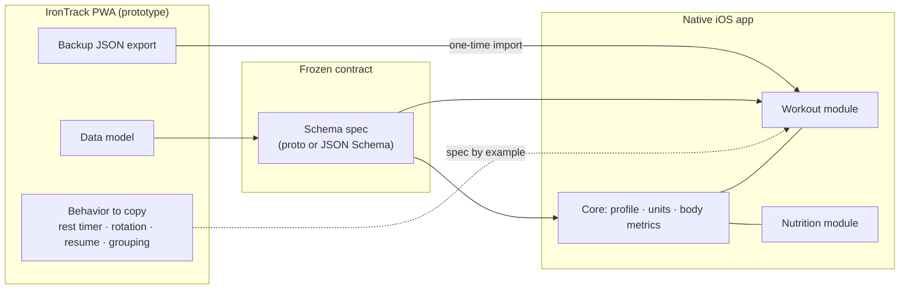
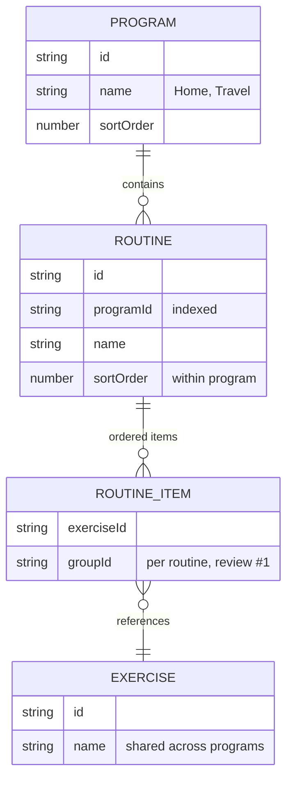
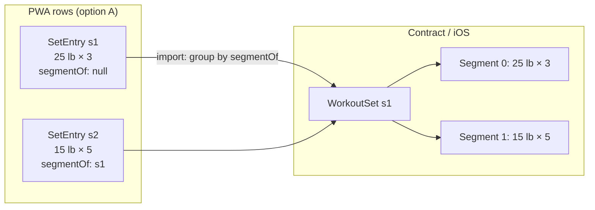
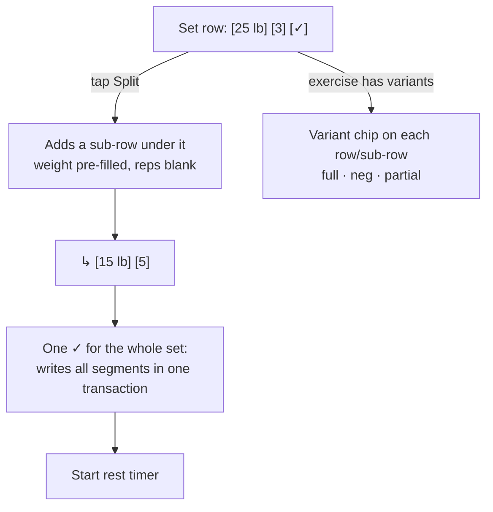
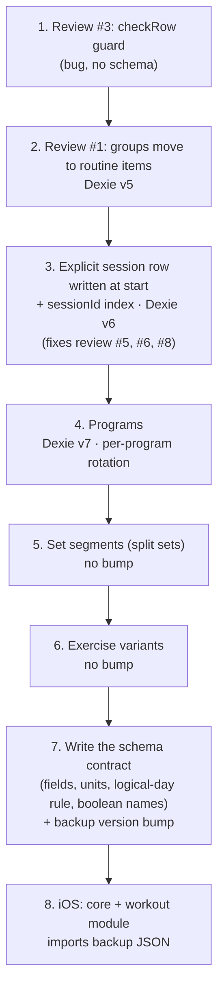

# Structural Roadmap: Programs, Split Sets, Exercise Variants, iOS

**Date:** 2026-11-10 · **Builds on:** [2026-11-10-opus-review.md](2026-11-10-opus-review.md) · **Status:** proposal, no code written

## TL;DR

- **The iOS goal changes the framework question.** If the end state is a native iOS app bundled with a nutrition tracker, both Vue and SvelteKit are throwaway. The lasting value of this PWA is its **data model and behavior**, so skip the SvelteKit migration completely and spend that effort on getting the schema right.
- **All three features are feasible**, and #2 and #3 are really one feature: a set made of **segments**, where each segment has its own reps, load and variant.
- **Recommended order:** fix the open data-model bugs first (per-routine groups, explicit sessions), then add Programs, then segments, then variants. Then **freeze the schema as a written contract** that the iOS app imports.

| Feature | Feasibility | Disruption | Dexie bump | Main risk |
|---|---|---|---|---|
| 1. Programs ("Home", "Travel") | Easy | Medium: Dashboard, Builder, rotation, sharing | Yes, plus a default-program upgrade | Rotation and share format must become program-scoped |
| 2. Split set (25 lb × 3, then 15 lb × 5) | Moderate | Medium: every consumer that reads reps or weight | No, if segments are linked rows | Defining "a set" for counts, PRs and charts |
| 3. Pull-up variants (full, negative, partial…) | Easy once #2 exists | Low | No | Chart and PR semantics per variant |

---

## 0. What the iOS goal changes



**Implications:**

- **Don't migrate web frameworks.** The SvelteKit section of the review assumed the web app was the product. It isn't, so the "stay on Vue" verdict gets stronger: change Vue only where a prototype feature needs it.
- **The backup JSON becomes the upgrade path.** A user's training history moves into the iOS app via the existing export. Every field you add now is a field the iOS importer has to understand, which is why schema changes should happen *before* the freeze. Per your naming rules, boolean fields need their predicate prefix before that point, because renaming after the freeze is a breaking change.
- **Body metrics belong to the shared core, not to the workout module.** Body weight is already used for bodyweight-exercise volume (`getBodyWeightLogs`). A nutrition app needs it too, for calorie targets. The same goes for unit preferences and the `todayString()` logical-day rule.
- **Several web limitations disappear on iOS:**

| PWA today | Native iOS |
|---|---|
| Best-effort rest alert; can't fire while the tab is suspended (`rest-alert.ts` header comment) | Local notification scheduled at `endAt`, always fires; a Live Activity can show the countdown on the lock screen |
| Wake Lock API, re-acquired on every visibility change | `isIdleTimerDisabled` |
| Service worker update toast | App Store updates |
| IndexedDB can be evicted by the browser | SwiftData or SQLite on device, plus optional iCloud |
| No health integration | HealthKit: write workouts, read and write body weight |

**Keep the PWA alive as the prototyping bench.** Features 1–3 are cheap to try here and you can test them in a real gym session before committing them to the contract.

---

## 1. Programs: switchable sets of routines

**Naming.** "Schedule" suggests a calendar (Mon/Wed/Fri), which this isn't. Candidates:

- **`Program` (recommended):** standard lifting vocabulary ("my travel program") and it scales to non-location uses like "Cut block" or "Rehab".
- `RoutineList`: literal but bland.
- `Location`: fits your example exactly but is wrong for non-location lists.



**Key decision: exercises stay shared across programs.** "Bench Press" at home and "Bench Press" while traveling is the same lift, so progress charts and ghost text stay continuous. This only works once groups live on the routine (review finding #1). Otherwise grouping exercises in the Travel program would change Home's supersets. **Do review #1 first, or together with this.**

**What's involved:**

1. Dexie upgrade: create a `programs` table and add an indexed `programId` to routines. The upgrade creates one default program ("My Routines") and assigns every existing routine to it. A fresh install seeds the same default.
2. Add an `activeProgramId` UI preference in `store.ts` (localStorage). It's a preference, not data.
3. Dashboard: a program switcher in the header (a segmented control or menu). The list shows only the active program's routines.
4. **Rotation becomes per program.** "Suggested next" uses the last finished workout *within the active program*. Otherwise a travel week throws off the home rotation. (This builds on review #6: base the rotation on `workouts`, not sets.)
5. Builder: a new routine goes into the active program. Add "Move to program…" in the swipe menu, and maybe "Copy to program" for cloning Home into Travel and swapping out equipment-dependent exercises.
6. Sharing: the export can include the program as a wrapper. Import goes into the active program or creates a new one.
7. History and progress: no change required. Filtering history by program is a nice-to-have, not part of the first version.

**Open questions:**
- Can one routine belong to several programs (many-to-many)? I'd say no, because copying is simpler and avoids "edit here changed it there" surprises, the same class of bug as review #1.
- Should the active program switch automatically by location? That's a good fit for iOS later, not for the PWA.

---

## 2 + 3. Split sets and exercise variants are one feature: set segments

Both scenarios are **one set made of several measured parts**:

| Scenario | Segment 1 | Segment 2 |
|---|---|---|
| Drop mid-set | 25 lb × 3 | 15 lb × 5 |
| Pull-up practice | full × 2 | negative × 3 |
| Both at once | full × 1 | band-assisted (green) × 4 |

So a **segment** is the atomic measurement (reps × load × variant), and a **set** is an ordered group of segments.

### Model options

| | A. Linked rows (recommended for the PWA) | B. Embedded array |
|---|---|---|
| Shape | Each segment is a `SetEntry` row; segments after the first have `segmentOf` = the first row's id | `SetEntry.segments: {reps, weightInLbs, unit, variant}[]` |
| Volume (`Σ weightInLbs × reps`) | **Already correct**: every row still has one weight and one rep count | Every consumer must loop over segments |
| PR max weight, ghost text, charts | Work unchanged at segment level | Rewrite each |
| Set count | Must count rows where `segmentOf` is empty (a 1-line change in each place) | Unchanged |
| Dexie bump | None (plain unindexed field, like `routineId`) | None, but it changes the row's shape |
| Old data | Every existing row is a 1-segment set; nothing to migrate | Needs migration or dual-shape reads |

```ts
// PWA: option A, additive and optional, like bandColors
interface SetEntry {
  // ...existing fields unchanged...
  segmentOf?: string | null;   // id of the set's first segment; absent/null = first or only segment
  variant?: string | null;     // e.g. 'negative'; absent = the exercise's default variant
}

interface Exercise {
  // ...existing fields...
  variants?: string[];         // user-editable, e.g. ['full', 'negative', 'partial', 'band-assisted']
}
```

**In the frozen contract, use the cleaner nested shape.** The iOS model can be `WorkoutSet` → `[SetSegment]`, which is natural in SwiftData. The importer converts linked rows into nested segments with a simple group-by on `segmentOf`. You get the cheap PWA change now and the clean model later.



### Semantics to decide up front

These are the real design work. The code is small once they're settled.

| Question | Proposal |
|---|---|
| Max reps PR for a drop set (3 + 5) | Count **per segment** (5). A drop set's total of 8 isn't comparable to a straight set of 8. |
| Ghost text ("Last: …") | Show the whole set: `25×3 → 15×5` or `2 full + 3 neg` |
| Progress chart for pull-ups | Filter by variant, defaulting to the first variant ("full"). Shows real progress: negatives going down, full reps going up. |
| Volume for partials and negatives | Count them like other reps. A weighted rep-quality factor is out of scope. |
| Rest timer | Starts when the **whole set** is checked, not after each segment |
| Variant list source | Per exercise, user-edited. Suggest defaults only for common names (pull-up, push-up, dip). |
| Variants vs. separate exercises ("Negative Pull-up") | Variants, because one set can mix them. Separate exercises can't record "2 full + 3 negatives" as one set. |

### UI sketch (Active Workout)



Saving the whole set in one transaction has a second benefit: it removes the `@change` auto-save path that causes review finding #3.

**What's involved:**

1. `SetEntry.segmentOf` and `variant`, plus `Exercise.variants`. Additive and optional, no Dexie bump.
2. `logSet`/`updateSet`: add a `logSetWithSegments` helper that writes all rows in one `db.transaction`.
3. `SetRowState` becomes a set holding `segments: SegmentRowState[]`. This is the biggest change, in `ActiveWorkoutScreen.vue` and `SetRow.vue`, and it's also how supersets zip rows by index (`groupedRows`), so it needs care.
4. Readers: set counts in History and session detail exclude follow-on segments. Ghost text and session detail group segments for display. The progress chart gets a variant filter.
5. Builder: a variants editor on the exercise row, next to the resistance/exercise type cycle.
6. Backup/sharing: no format change, since the new fields ride along. Bump the backup `version` so older app builds can warn before importing.

---

## 4. Proposed order

Each step is its own EDD or atomic commit. Dexie versions stay one per feature (v5, v6, …) instead of one big upgrade.



Why this order:

- **Steps 2 and 4 both reshape `Routine`.** Doing groups first means Programs is built on the final routine shape.
- **Step 3 before Programs:** rotation per program needs reliable "last finished workout" data, which only explicit sessions provide.
- **Segments before variants:** variants are a field on a segment. Building them first would mean a temporary per-set variant that later needs splitting.
- **Contract last:** it freezes what the prototype taught you. Everything before it is cheap to change.

## 5. Questions for you

1. Name: `Program`, or something else?
2. Should a routine belong to exactly one program (copy to share), or to several?
3. Should max-reps PRs count per segment or per set total?
4. Is the nutrition app further along than this one? If so, its schema conventions (ids, dates, units) should drive the shared core instead of IronTrack's.
