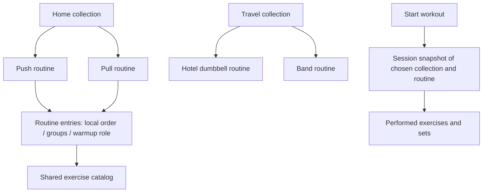
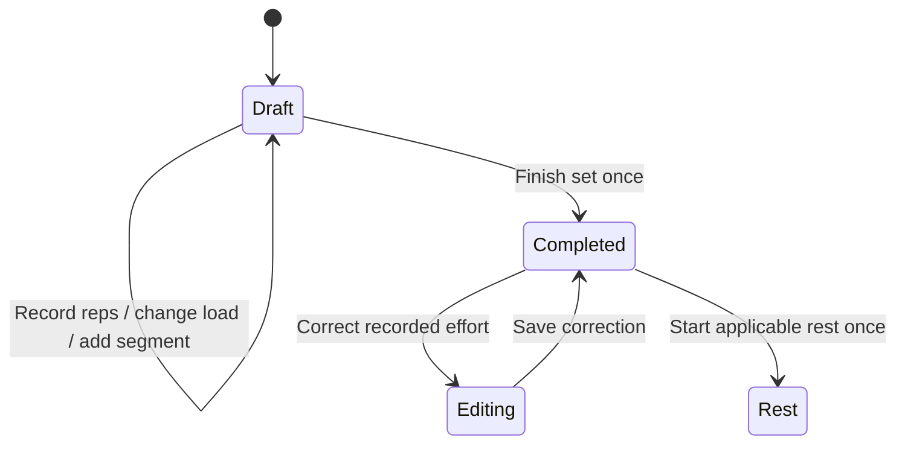
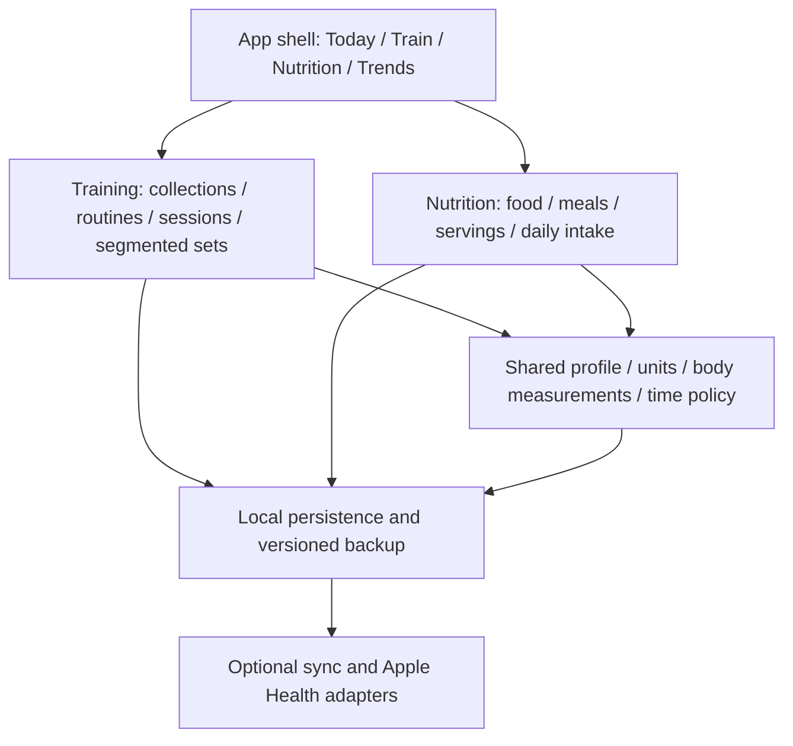

# From workout prototype to a combined training and nutrition app

**Author: GPT-6 Astra · 10 November 2026 · Architecture discussion, not an implementation commitment**

> **All three features are feasible. The important change is to model a workout as a durable record of what happened, independent of the routine template.** Add a parent collection for routines, and represent each performed set as one or more ordered segments. Resolve the iOS direction before spending effort on a web-framework rewrite.

This discussion builds on the [code review](../codex-gpt-6-review.md). The workout source was inspected; the separate nutrition app was not available in this repository, so integration scope remains conditional. No application code was changed. Shapes below illustrate contracts rather than finalized schemas.

## 1. The original goal changes the recommendation

The existing Vue app has already served a valuable purpose: it exposed actual logging behavior and where the first data model is too restrictive. Preserving every component is less important than carrying those lessons into the intended product.

The prior “maintain Vue” recommendation applies to improving the current web app. For a combined app with an iOS-native experience, the first decision is **the presentation/runtime target**, followed by the data model. Switching Vue to SvelteKit does not itself resolve the native experience or any of these structural requirements.

| Product priority | Direction worth exploring | What carries forward |
|---|---|---|
| Native iOS controls, navigation, accessibility, and deep Apple integration are central | SwiftUI app with native persistence | Product behavior, IDs, export contracts, domain rules, migration fixtures; most UI and DB access are rewritten |
| Fastest path to a combined app with substantial web-code reuse | Existing Vue UI in a Capacitor iOS shell | Most Vue/TypeScript; native integrations and mobile polish still require work |
| A substantial web product with future server-rendered/public features | Revisit SvelteKit or a Vue full-stack option | Separate decision from native packaging; no established benefit for the logging model |

SwiftUI provides Apple's declarative UI framework and interoperates with UIKit. Capacitor provides an iOS runtime and a JavaScript-to-native bridge, and copies a built web bundle into a native project. Those are materially different reuse paths. [SwiftUI](https://developer.apple.com/swiftui/), [Capacitor iOS](https://capacitorjs.com/docs/ios), [Capacitor installation](https://capacitorjs.com/docs/getting-started).

**My recommendation:** if “native” describes the product quality and controls you want, prototype the workout-entry flow in SwiftUI before doing another web rewrite. If it primarily means an installable App Store app that shares a web codebase, evaluate Capacitor first. The existing prototype can remain useful while that decision is made; it does not need every architectural improvement before exploration begins.

An iOS experiment should include numeric entry, keyboard dismissal, segmented-set editing, app suspension/resume, persistent storage, and rest completion while locked. A wrapper alone does not establish these behaviors. Choose native notification/lifecycle integrations where needed; do not assume JavaScript intervals will run while suspended. Keep the native bundled-asset/update lifecycle separate from the PWA service-worker lifecycle.

## 2. Home and Travel: use a routine collection

**Suggested UI name: “Routine collections.” Suggested domain name: `RoutineCollection`.** Home and Travel describe contexts containing routines. “Schedule” implies dates or weekdays; reserve that for actual calendar assignment. “Training plan” becomes appropriate if the parent later owns progression, weeks, or phases.

The smallest useful version is a named, ordered collection with a selected collection in preferences. Selecting Travel changes the routine list and suggestions. It does not alter previous workouts or interrupt an active Home workout.



**Recommended first version: one collection owns each routine.** This avoids accidental linked edits across Home and Travel. “Copy to another collection” creates a new routine and new routine-entry IDs but reuses exercise catalog IDs. A future membership table can support deliberate reuse if that need appears; do not introduce it just to organize two lists.

```ts
// Current
Routine { id, name, exerciseIds, sortOrder }

// Proposed, abbreviated
RoutineCollection { id, name, sortOrder, archivedAt? }
Routine { id, collectionId, name, entries: RoutineEntry[], sortOrder }
RoutineEntry { id, exerciseId, groupId, exerciseType, order }
// Preferences: selectedCollectionId
// Session: collectionId + routineId + labels/entry snapshot at start
```

Move group and warmup metadata from shared exercises to routine entries as part of this boundary change. Otherwise a different grouping or warmup role in Travel still changes Home—the coupling already identified in the review.

| Behavior | Proposed rule |
|---|---|
| Suggested next routine | Rotate within the selected collection, based on completed sessions in that collection |
| Switch collections during a workout | Keep one active workout; show its originating collection in Resume |
| Copy routine | Independent entry metadata; shared exercise identity for progress tracking |
| Archive collection or routine | Preserve history and snapshots; exclude from new-workout selection |
| Routine/exercise renamed later | Historical display keeps recorded labels; catalog identity still supports aggregated history |
| Existing data | Put existing routines in a deterministic “Default” collection and preserve their order |

The current dashboard derives suggestions from the latest **set**, despite its completion-oriented comment. Adding a collection filter alone will retain that mismatch; use completed sessions explicitly. Relevant files: [DashboardScreen.vue](../../src/features/dashboard/DashboardScreen.vue), [routines.ts](../../src/shared/db/routines.ts), [schema.ts](../../src/shared/db/schema.ts).

**Scope: moderate.** The list/filter UI is small; copying, rotation, session context, archiving, and backup compatibility are the real work. No equipment database or GPS-based location detection is necessary for the first version.

## 3. Changing weight mid-set: a set has segments

You should be able to record the whole effort as **one set** without pretending it used one weight. For example, if the second portion is five reps:

| Set | Segment | Load | Reps |
|---|---|---|---|
| 1 | 1 | 25 lb | 3 |
| 1 | 2 | 15 lb | 5 |

Result: **one set, eight reps, 150 lb·reps of external-load volume** (`25×3 + 15×5`). Neither 25 lb × 8 nor two independent sets describes this correctly.

The current [SetEntry](../../src/shared/db/schema.ts) stores one load and rep count per row. Replace that assumption with a parent set and an ordered segment array. Most ordinary sets still have exactly one segment; the simple logging experience remains the default.

```ts
// Current, abbreviated
SetEntry { id, exerciseId, reps, weightEntered, unit, weightInLbs }

// Proposed: snapshots carry the interpretation of the recorded effort.
PerformedSet {
  id, sessionId, sessionExerciseId,
  status: 'draft' | 'completed',
  segments: Array<{
    id: string;
    reps: number;
    variationId: string | null;
    variationLabel: string | null;
    load: LoadSnapshot;
  }>
}
```

`LoadSnapshot` should distinguish external weight, bodyweight, band resistance, and assistance. Keep entered value/unit plus canonical mass where appropriate. A blank legacy weight is not enough evidence to infer bodyweight or assistance. Assistance is a separate mode, not an unexplained negative weight.

**Storage recommendation:** initially embed the small segment array inside its parent set so updates can be atomic and the set remains the natural edit/delete/export unit. Give segments stable IDs anyway. Separate segment records become useful if independent synchronization or query needs justify them.



**Interaction:** a row starts with weight + reps. “Change weight / add segment” records the completed portion and opens another portion under the same set. “Finish set” completes the entire set. Permit splitting an already logged set afterward too; people may only enter the details after putting the weight down.

The existing reps-field `change` handler immediately saves a set and can start rest. That behavior must be redesigned: autosaving a draft is separate from completing a set. A segment boundary must not trigger rest. In supersets/circuits, preserve the current round-completion rule, applied to completed parent sets rather than individual segments. Corrections must not restart rest.

**Scope: substantial domain/UI change.** Touches logging, draft resume, history editing, last-session hints, PRs, volume, set counts, import/export, and grouped exercise timing. It is still a straightforward model change, not a new framework problem.

## 4. Mixed pull-ups: use those same segments with structured variations

The same model records:

| Set | Segment | Variation | Reps |
|---|---|---|---|
| 1 | 1 | Full pull-up | 1 |
| 1 | 2 | Negative | 3 |
| 1 | 3 | Partial from standing | 4 |

Store **one set with an ordered breakdown**. Display “1 full · 3 negatives · 4 standing partials.” Repeating a variation later in the set is allowed; ordered segments preserve what happened, while a summary can combine counts by variation.

Use stable variation IDs under the Pull-up exercise, with a readable label snapshot in each segment. Provide the variations you actually use and an optional custom label/note. A note alone cannot reliably power progress charts. Separate exercises for every variation would scatter one effort across the log and make later comparisons harder.

Keep **execution variation** and **load/assistance** independent. A full pull-up may be bodyweight, weighted, or band-assisted; “negative” does not specify resistance. Avoid a large movement taxonomy initially. Duration/tempo can be an optional future segment measurement if recording the length of a negative becomes useful.

**Analytics must preserve meaning:**

- Count parent sets as sets; sum segment reps for total reps, with the variation breakdown always accessible.
- Track full pull-up progress separately from negatives and partials. Eight mixed repetitions are not an eight-full-pull-up PR.
- Compare weighted PRs within compatible variation and assistance modes. Do not compare external load with assistance as if larger always meant stronger.
- Calculate external-load volume by summing compatible segment contributions. Do not mix raw reps and mass-times-reps in one series—the existing volume-unit bug becomes more serious with these features.
- Treat bodyweight-derived volume as an explicitly labeled estimate if offered; avoid claiming equal work for full, negative, and partial reps.

**Scope: modest incremental work after segments exist.** The variation picker and breakdown are manageable; the consequential decisions are historical interpretation and what counts as comparable progress. Implementing weight splits and pull-up annotations independently would duplicate much of the same machinery.

## 5. Combining nutrition and training

Use one app shell with separate training and nutrition domains, joined through a small shared foundation. “One app” does not require one generic log schema.



Body weight should have one owner and one history; both domains consume it. Share unit conversion and local-day/timezone policy, but keep meal quantities separate from exercise loads. Snapshots matter in both domains: changing a food's current nutrition values should not silently rewrite an old meal, just as editing a routine should not rewrite a workout.

Start with **Today** as a composition of the two domains' summaries, rather than merging their write paths. Combining the domains does not automatically require accounts, a backend, or sync. If multi-device use becomes a requirement, add stable record ownership, revision/conflict policy, deletion tombstones, and sync status deliberately; UUIDs alone do not solve synchronization.

HealthKit is an optional integration boundary, not the primary storage model for routines or detailed segmented sets. Request the specific read/write types when needed, and keep core logging functional without authorization. Apple requires per-type authorization and intentionally does not expose whether a read permission was denied. [HealthKit authorization](https://developer.apple.com/documentation/healthkit/authorizing-access-to-health-data).

Before estimating the merge, inspect the nutrition app's stack, storage, units, date handling, identity model, and food-source contracts. Its existing architecture may materially change the UI reuse decision.

## 6. Preserve the prototype's data without preserving its limitations

| Transition | Proposed approach |
|---|---|
| Existing routines → collections | One Default collection; stable IDs and original ordering |
| Shared exercise grouping → routine entries | Copy grouping and warmup metadata into each routine's entries; retain exercise IDs |
| Existing sets → segmented sets | Preserve set ID; normalize to one segment with existing reps/load/bands |
| Missing historical variation | Mark as unspecified; never infer that old pull-ups were full reps |
| Missing historical names/types | Best-effort snapshot from available metadata, explicitly unknown where unrecoverable |
| New records → export | New payload version, runtime validation, and round-trip tests including drafts and segments |
| Old app reads new backup | Reject unsupported versions clearly; never silently flatten segments |
| Browser PWA → native installation | Explicit export/import or designed sync; do not assume browser IndexedDB is accessible to the native app |

Persist active sessions and draft sets in the durable domain store, with explicit status. Current active-session localStorage is outside the backup payload and does not provide a complete transferable session. Starting a workout should capture its routine context; completion should be retry-safe and should await pending set writes. Keep an original backup before migration, and make the migration atomic and repeatable.

## 7. Useful order of work

| Step | Deliverable / decision | Why first |
|---|---|---|
| 1 | Agree on collection ownership, segment semantics, and comparison rules using the examples above | Stabilizes the contracts across any frontend |
| 2 | Inspect nutrition app; test one real iOS entry/resume flow in the likely runtime | Prevents choosing a stack based only on this prototype |
| 3 | Fix duplicate writes/import validation and define versioned migration fixtures | Protects data before changing its structure |
| 4 | Add collections plus routine-entry ownership | Separates templates/context from historical workouts |
| 5 | Build segmented sets and variations together, including draft recovery and analytics | Implements both new logging scenarios coherently |
| 6 | Compose training and nutrition in the app shell | Reuse shared units/measurements without coupling domain logic |
| 7 | Add native integrations and sync only to the required depth | Keeps early work grounded in demonstrated product needs |

This is a suggested dependency order, not a requirement to implement everything in Vue before building native. If the iOS experiment chooses SwiftUI, implement the agreed contracts in the native app and keep the web prototype as a behavior reference.

**Decisions worth discussing next:**

1. Does “native” mean Apple-native controls and interactions, or primarily an App Store app with web reuse? My leaning is SwiftUI exploration if the former is the intended destination.
2. Should the same routine ever be intentionally linked between Home and Travel? Default to independent copies until that need is demonstrated.
3. Is exact segment order valuable, or mainly per-variation totals? Store ordered segments either way; show a compact total by default.
4. Must the first combined version sync across devices? Default to local-first with reliable export/import until the requirement is explicit.

**Recommended foundation:** collection → routine entries → session snapshot → performed sets → ordered segments. That supports all three requests and is reusable as a product/data contract even if the final UI is completely native.
